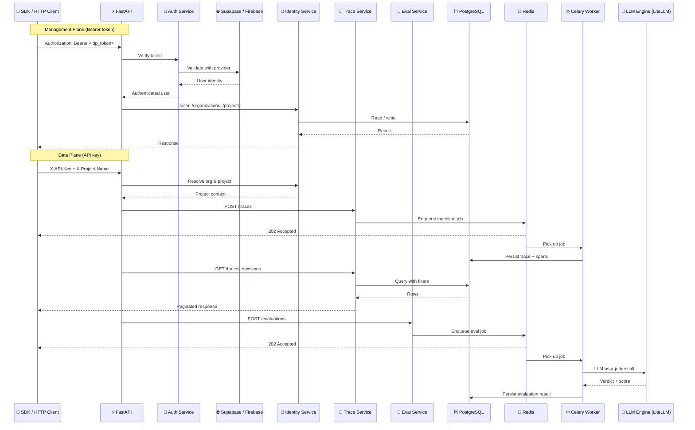

<div align="center">
  <a href="https://pandaprobe.com/" target="_blank" rel="noopener noreferrer">
    <picture>
      <source media="(prefers-color-scheme: dark)" srcset="docs/assets/logo/dark.png">
      <source media="(prefers-color-scheme: light)" srcset="docs/assets/logo/light.png">
      
    </picture>
  </a>
</div>

<div align="center">
  
</div>


<p align="center">
  <a href="https://app.pandaprobe.com/" target="_blank"></a>
  <a href="https://docs.pandaprobe.com/" target="_blank"></a>
  <a href="https://x.com/PandaProbe" target="_blank"></a>
</p>

<p align="center">
  <a href="https://pypi.org/project/pandaprobe/" alt="PyPI Downloads"></a>
  <a href="LICENSE"></a>
  <a href="https://www.pandaprobe.com/" alt="Website"></a>
  <a href="https://discord.gg/A2VfrRhx"></a>
  <br/>
  <a href="https://github.com/chirpz-ai/pandaprobe/actions/workflows/build.yml"></a>
  <a href="https://github.com/chirpz-ai/pandaprobe/actions/workflows/lint.yml"></a>
  <a href="https://github.com/chirpz-ai/pandaprobe/actions/workflows/test-unit.yml"></a>
  <a href="https://github.com/chirpz-ai/pandaprobe/actions/workflows/test-integration.yml"></a>
  <a href="https://github.com/chirpz-ai/pandaprobe/actions/workflows/codeql.yml"></a>
</p>

## What is PandaProbe?

PandaProbe is an open source agent engineering platform for tracing, evaluating, and improving AI agents. It helps you understand what happened, check whether the work succeeded, and give your agent feedback it can use to make fewer mistakes.

- **Trace** captures model calls, tool use, inputs, outputs, errors, latency, and usage. Group related executions into sessions to follow a conversation or task.
- **Evaluate** measures the quality of traces and sessions, records programmatic scores, and identifies failures that need attention.
- **Reflect** brings failure evidence back to your agent through a persistent rule filesystem. The agent proposes reusable guidance; independent validation tests changes before accepting them as shared rules for future runs.

Python and TypeScript SDKs connect to supported agent frameworks and model providers while preserving your existing agent, tools, and application logic. Start with tracing, add evaluations suited to your task, and enable Reflect when you have reproducible cases and outcome checks.

Use [PandaProbe Cloud](https://app.pandaprobe.com/) for a managed deployment, or self-host the community project using the instructions below.

## Documentation

Explore the docs:

- [Tracing quickstart](https://docs.pandaprobe.com/tracing/get-started/quickstart)
- [Evaluation quickstart](https://docs.pandaprobe.com/evaluation/get-started/quickstart)
- [Reflect quickstart](https://docs.pandaprobe.com/reflect/quickstart)

<p align="left">
  <a href="https://docs.pandaprobe.com/overview" target="_blank">
    
  </a>
</p>

## PandaProbe Cloud

Managed deployment by the PandaProbe team, generous free-tier, no credit card required.

<p align="left">
  <a href="https://app.pandaprobe.com/" target="_blank">
    
  </a>
</p>

## Self-host PandaProbe

> **Prerequisites:** [Docker](https://docs.docker.com/get-docker/) must be installed and running.

```bash
git clone https://github.com/chirpz-ai/pandaprobe.git
cd pandaprobe
./start.sh
```

Once running, open:
- **Dashboard** — http://localhost:3000
- **API reference** — http://localhost:8000/scalar

## Architecture



## Services

| Service | Description | Port |
|---|---|---|
| **frontend** | Next.js dashboard | 3000 |
| **app** | FastAPI application server | 8000 |
| **worker** | Celery background worker | — |
| **beat** | Celery Beat scheduler | — |
| **postgres** | PostgreSQL 16 | 5432 |
| **redis** | Redis 7 (broker + cache) | 6379 |

## Contributing

We welcome contributions! Please read the [Contributing Guide](CONTRIBUTING.md) for instructions on setting up your development environment, building from source, running tests, and submitting pull requests.

## Authors

Built by the [Chirpz AI](https://pandaprobe.com/about) team. Contact sina@pandaprobe.com for enquiries.

## License

PandaProbe is licensed under Apache 2.0 — see [LICENSE](LICENSE) for details.
