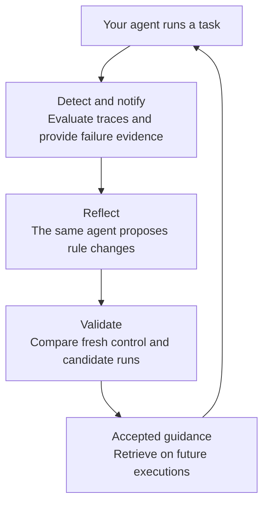

PandaProbe Reflect connects evaluation results to your agent’s memory. When an execution fails configured checks, Reflect gives the same agent evidence to investigate and a filesystem in which to propose reusable guidance. Independent tests decide whether those changes become accepted rules for future executions.

## The loop

1. **Detect.** Reflect captures trace IDs inside an explicit application boundary, waits for persisted traces, and requests platform evaluations. Configured thresholds and trajectory signals determine whether to create a notice.
2. **Notify.** The notice and diagnostic evidence become read-only files assigned to that execution. Judge explanations are evidence to investigate, not unquestionable instructions.
3. **Reflect.** The same task agent continues at a bounded checkpoint. It searches existing rules and proposes a coherent change through `reflect_bash`, or leaves the rules unchanged.
4. **Validate.** Your replay or matched trial supplies independently checked outcomes. The SDK compares control and candidate results and publishes an accepted revision only when its criteria are met.

The same model and agent behavior are reused; framework adapters may clone or reconstruct native objects for isolation. There is no separately configured reflection model.

## Who owns what?

| You provide | Reflect provides |
| --- | --- |
| Agent, model, prompt, business tools, conversation state | One isolated filesystem tool and current memory instructions |
| Existing PandaProbe tracing | Capture of the traces for each execution |
| Meaningful task boundaries | Evaluation scheduling, signals, notices, bounded continuation |
| Reproducible cases, fresh business state, outcome verifier | Paired validation, versioned proposals, accepted rule publication |

Native integrations restrict reflection to memory administration. For a custom loop, you implement the same restriction in the actual tool dispatcher.

## Execution, session, and workspace

- **Execution:** one application invocation and its evidence. Use a unique ID for every invocation, including retries.
- **Session:** related work, such as a customer conversation. A session is not a unique execution.
- **Workspace:** durable rules, proposals, evidence, and bookkeeping. Multiple sessions can use it; each execution gets an isolated working view.

Choose a boundary that includes the complete work you intend to evaluate. A final task can trigger reflection from a single low score. Intermediate work can use `completed=False` in Python or `completed: false` in TypeScript, allowing trajectory signals without classifying incompleteness alone as final failure.

## Detection defaults

The primary metrics are `task_completion` and `coherence`, both with threshold **0.5**. For an execution containing several traces, Reflect uses the lowest score per metric.

For each metric, signals are checked in order:

| Signal | Condition |
| --- | --- |
| `below_threshold` | A completed execution scores strictly below its threshold |
| `regression` | Otherwise, a score below threshold falls at least 0.15 from the preceding score |
| `stalled` | Otherwise, enough history is below threshold with variation below 0.02; the default window is five executions |

A score equal to its threshold does not breach it. Repeated observations of the same execution do not create a trajectory. Cooldowns suppress repeated signatures. Missing or unusable scores never count as success.

When a notice is created, `tool_correctness` and `argument_correctness` provide follow-up diagnosis by default. Diagnostic failure does not erase the primary notice. Sampling, concurrency, and an optional evaluation cap control work; see [Configuration](/reflect/configuration).

## Proposal, acceptance, and improvement are different

A file change creates a **candidate**. A candidate can remain **pending**, become **accepted**, or be **rejected** after validation. Additions, edits, merges, moves, and removals use the same process.

Ordinary fresh executions start with accepted rules. Candidate text is visible in its authoring execution and explicitly assigned trials. The proposing agent cannot publish its own changes through the shell.

Accepted guidance has supporting evidence under tested conditions. It still has to be retrieved and applied in a future execution. Reflect does not guarantee compliance, permanently eliminate a failure, or require a whole-file delivery checker before acceptance.

Continue with [Rules and memory](/reflect/rules-and-memory) or [Validation](/reflect/validation).
